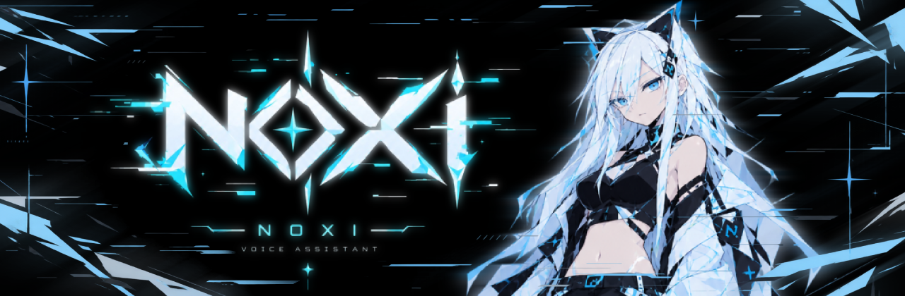
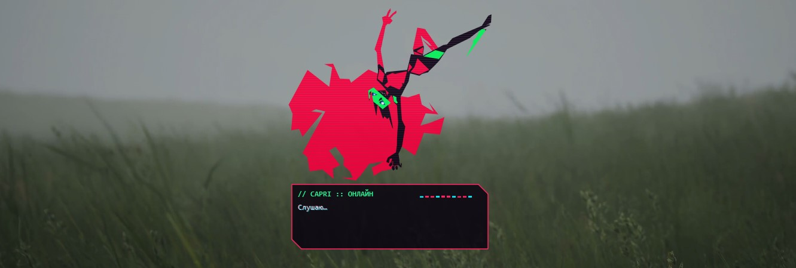
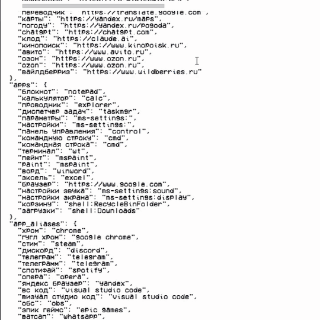
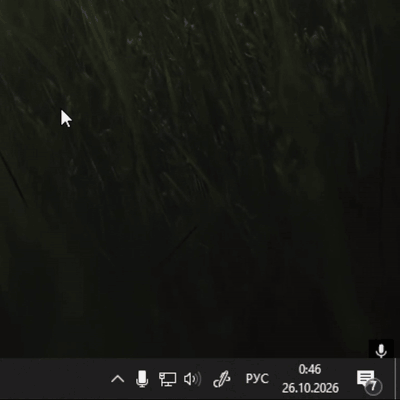

<p align="center">
  
</p>

<p align="center">
  
  
  
  
  
</p>

<p align="center">
  <b>Капри</b> — голосовой ассистент в стиле киберпанка. Живёт поверх окон, появляется с глитч-вспышками,<br>
  слушает команды на русском, управляет компьютером и болтает с помощью локальной нейросети.
</p>

<h2 align="center">Этот проект сделан с помощью ИИ</h2>

<p align="center">
  Код, оформление и документация написаны вместе с нейросетью.
</p>

> **О характере Капри.** Её характер собран из разных источников. Она болтает через локальную нейросеть, поэтому её поведение в диалогах
> может быть кринжовым.

<p align="center">
  
  &nbsp;
  
</p>

<p align="center">
  
</p>

---

## Что умеет

| | |
|---|---|
| **Интернет** | открывает сайты, ищет в Google, картинки и информацию — с пересказом из Википедии |
| **YouTube** | «открой (ваше видео)» — сразу включает первое видео; поиск прямо на YouTube |
| **Музыка и видео** | пауза, следующий трек, «что играет», перемотка, **«поставь на 3:14»**, «начни с 27-й минуты» |
| **Telegram и текст** | «открой телеграм, чат папа, напиши привет» — находит чат, печатает и отправляет |
| **Программы и окна** | открывает и закрывает программы, завершает процессы, вкладки, сворачивание, прокрутка страниц |
| **Клавиши** | «нажми вин таб», «контрол шифт эскейп», «альт эф четыре» |
| **Файлы** | открывает папки и диски, создаёт папки, текстовые файлы, документы и таблицы |
| **Компьютер** | громкость, яркость, диагностика ПК, «что грузит компьютер», скриншот, блокировка |
| **Разговор** | бесплатная локальная нейросеть со своим характером — без интернета и ключей |
| **Сама по себе** | меняет позы, гуляет по экрану, скачет молнией, пока отвечает, иногда появляется сама |

> **Работает и без нейросети** — все команды доступны сразу после установки. Нейросеть нужна только для болтовни.

Полный список фраз — в [КОМАНДЫ.md](КОМАНДЫ.md).

---

## Установка

**Нужно:** Windows 10 или 11, микрофон, интернет на время установки.

### 1. Установи Python
Скачай **Python 3.13**: [установщик для Windows (64-bit)](https://www.python.org/ftp/python/3.13.17/python-3.13.17-amd64.exe).
Подойдут и 3.11–3.14, все версии — на https://www.python.org/downloads/windows/
С Python 3.15 и новее голос Капри пока не работает. Если стоит только 3.15, `setup.bat` сам доставит 3.13 рядом.
При установке **обязательно поставь галочку «Add python.exe to PATH»**.

### 2. Скачай Капри
Зелёная кнопка **Code → Download ZIP** вверху страницы (или архив `capri.zip`, если получил его, например, в Telegram).
**Распакуй** архив в удобную папку, например `Документы\capri` — из архива запускать нельзя.

> Лучше, чтобы в пути к папке не было русских букв — так надёжнее работает распознавание речи.

### 3. Запусти `setup.bat`
Установит библиотеки и скачает офлайн-модель распознавания речи (~45 МБ). Дождись надписи «Готово».

> Если Windows покажет «Windows защитила ваш компьютер» — **«Подробнее» → «Выполнить в любом случае»**.
> Так Windows реагирует на любые .bat-файлы из интернета.

### 4. Запусти `run.bat`
Капри появится и поздоровается, в трее у часов появится её иконка.
Скажи **«Капри, открой ютуб»** — если открылось, всё работает.

> Windows может спросить доступ к микрофону — разреши. Нужный микрофон можно выбрать в меню трея → **«Микрофон»**.

---

## Как научить Капри разговаривать

Капри болтает через **[Ollama](https://ollama.com/download)** — бесплатную программу, которая запускает нейросеть прямо на компьютере.
Никаких ключей, подписок и отправки разговоров в интернет.

1. Установи Ollama: https://ollama.com/download
2. В «Командной строке» скачай модель (~5 ГБ):
   ```
   ollama pull qwen3:8b
   ```
3. Перезапусти Капри (меню в трее → «Выход», затем `run.bat`).

Нужна видеокарта с 8 ГБ памяти или 16+ ГБ оперативной памяти. На слабом компьютере возьми `qwen3:4b-instruct`
(именно `-instruct`: обычная `qwen3:4b` — «думающая» версия, она проговаривает рассуждения вслух)
и укажи её в `config.json` → `"local_model"`.

Свежие данные (погода, новости, курсы) нейросеть не знает — на такие вопросы Капри откроет поиск.

<details>
<summary><b>Вариант: Claude вместо локальной нейросети</b></summary>

Если есть ключ Anthropic API: в `config.json` поставь `"enable_ai": true` и впиши ключ в `"anthropic_api_key"`.
Claude умнее и видит свежие данные через веб-поиск, но это платно и через интернет.
</details>

---

## Настройка

### Свой сайт

Если Капри не знает нужный сайт, научи её: меню в трее → **«Открыть config.json»**, найди раздел `"sites"`
и добавь строку с названием и адресом. Название и адрес — в кавычках, в конце строки — запятая:

```
"мой сайт": "https://адрес-сайта.ру",
```

<p align="center">
  
</p>

### Перезапуск Капри

После изменений в `config.json` Капри нужно перезапустить: значок в трее → **«Выход»**, затем снова `run.bat`.

<p align="center">
  
</p>

<details>
<summary><b>Автозапуск вместе с Windows</b></summary>

1. **Win + R** → `shell:startup` → Enter — откроется папка автозагрузки.
2. Перетащи туда `run.bat`, **удерживая Alt** (создастся ярлык).

Убрать — удали ярлык из этой папки.
</details>

<details>
<summary><b>config.json — все настройки</b></summary>

Файл появляется после первого запуска. Открыть: меню в трее → «Открыть config.json». После изменений перезапусти Капри.

| Параметр | Что меняет |
|---|---|
| `wake_words` | слова, на которые Капри откликается |
| `mic_device` | микрофон (удобнее выбрать в меню трея → «Микрофон»); `null` — как в Windows |
| `sites` | свои сайты: `"название": "https://адрес"` |
| `apps`, `app_aliases` | свои программы и их русские названия |
| `local_ai`, `local_model` | разговор через Ollama и какая модель |
| `enable_ai`, `anthropic_api_key` | разговор через Claude |
| `voice`, `voice_pitch`, `voice_rate` | голос, высота и скорость речи |
| `voice_fx` | цифровая обработка голоса: `0` — чистый, `1` — полный эффект |
| `use_google_stt` | точнее распознавать фразы через Google (нужен интернет) |
| `barge_in` | можно ли перебивать Капри голосом |
| `type_press_enter` | отправлять ли сообщение после «напиши …» |
| `chatter`, `chatter_min_minutes`, `chatter_max_minutes` | появляется ли сама и как часто |
| `roam_chance` | как часто при этом гуляет по экрану (`0`…`1`) |
| `teleport_on_answer` | скакать молнией по экрану во время ответа |
| `hide_after_seconds` | через сколько секунд тишины исчезает |
</details>

<details>
<summary><b>Свои позы и анимации</b></summary>

- **Позы** — картинки в `assets/poses` (PNG/WebP с прозрачным фоном). Капри меняет их каждые 12–30 секунд.
  `capri_roam.png` — поза для прогулок.
- **Анимации** — кадры в `assets/anim/capri` (машет рукой) и `assets/anim/eyes` (пока думает). Свои — из видео:
  ```
  python tools/convert_anim.py "видео.mp4" capri white
  ```
  Последнее слово — цвет фона в видео: `white`, `black` или `green`.
</details>

<details>
<summary><b>Офлайн-голос Silero</b></summary>

По умолчанию голос — синтезатор Microsoft (нужен интернет). Офлайн-вариант:
```
pip install torch --index-url https://download.pytorch.org/whl/cpu
```
и в `config.json`: `"tts_engine": "silero"`, `"silero_voice": "kseniya"` (или `xenia`, `baya`).
Модель (~40 МБ) скачается сама. Лицензия Silero — только для некоммерческого использования.
</details>

---

## Если что-то не работает

<details>
<summary><b>Частые проблемы</b></summary>

| Проблема | Что сделать |
|---|---|
| Капри не слышит | выбери микрофон в меню трея → «Микрофон»; проверь доступ к микрофону в настройках конфиденциальности Windows |
| «Не найдена модель распознавания речи» | запусти `setup.bat` ещё раз |
| Голос не Капри, а стандартный голос Windows | нужен интернет; если стоит Python 3.15, поставь Python 3.13 и запусти `setup.bat` ещё раз |
| Отвечает только поиском в Google | установи Ollama и модель; проверь, что Ollama запущена (иконка ламы в трее) |
| Перебивает сама себя | надень наушники или поставь `"barge_in": false` |
| Яркость не меняется | работает только на ноутбуках и мониторах с поддержкой DDC/CI |
| Не открывает программу | добавь её в `config.json` → `apps` (`"название": "путь\\к\\программе.exe"`) |
| Не находит чат в Telegram | нужен Telegram Desktop; называй чат так, как он подписан в списке |
| «Не смогла переключиться на окно» | кликни по нужному окну и повтори |
| `setup.bat` не находит Python | переустанови Python с галочкой «Add python.exe to PATH» |
| Что-то сломалось | подробности — в файле `capri.log` рядом с программой |
</details>

---

## Приватность

- Распознавание речи — офлайн (Vosk). С `use_google_stt` фраза после имени уточняется через Google.
- Голос синтезируется сервисом Microsoft — отправляется только текст ответа Капри.
- Разговоры с Ollama не покидают компьютер. Журнал и отчёты хранятся только локально.

---

<p align="center">
  <sub>Некоммерческий фан-проект. Персонаж Капри и вселенная Cyberpunk: Edgerunners принадлежат их правообладателям.</sub>
</p>
